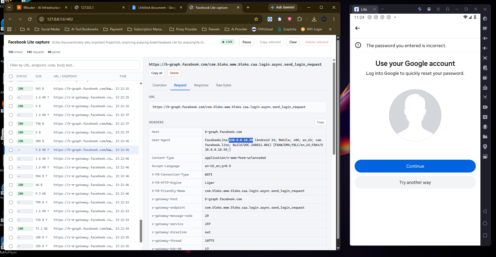

<p align="center">
  
</p>

# Facebook Lite SSL Pinning Bypass

Bypass Facebook Lite SSL pinning on Android devices.  
Supported ABIs: `arm64-v8a`, `armeabi-v7a`, `x86`, `x86_64`  
Latest tested version: `v538.0.0.10.59` (and `v538.x` series)  
Target Application: `com.facebook.lite`

[](https://play.google.com/store/apps/details?id=com.facebook.lite)
[]()
[]()
[](https://t.me/sifathub)

---

## 📌 Overview

This project showcases the successful **Facebook Lite SSL Pinning Bypass**, protocol research, and live decrypted traffic interception on modern Android environments.

Unlike regular Facebook (`com.facebook.katana`) or Messenger (`com.facebook.orca`), which communicate via standard HTTP/HTTPS REST APIs through OkHttp and Liger, **Facebook Lite utilizes a completely unique, hardened security and networking architecture**.

Standard public SSL bypass tools (such as universal Android Frida scripts, TrustManager hooks, or public proxy certificates) **fail completely** on Facebook Lite. Meta's client security drops any unverified connection, rendering standard MITM proxy tools ineffective out of the box.

To overcome these advanced security barriers, we engineered a **comprehensive, proprietary bypass and capture pipeline**. By combining **multiple custom Frida instrumentation scripts, dedicated Python coordination tools, our own custom-configured CA certificate authority, and an automated runtime injection framework**, we successfully bypassed Facebook Lite's SSL pinning and intercepted full application traffic and live authentication sessions in plaintext.

---

## 🎬 Proof of Concept & Evidence

### 1. 🎥 Live Demonstration Walkthrough

Live execution demonstration showing custom Facebook Lite SSL bypass, runtime injection pipeline, and plaintext traffic interception:

<p align="center">
  
</p>

<p align="center">
  <a href="assets/Facebook%20lite%20ssl%20bypass%20video.mp4">
    
  </a>
</p>

---

### 2. 📸 Intercepted Traffic & Decrypted Evidence

#### Decrypted Application Traffic & Authentication Flow
Verified capture demonstrating decrypted Facebook Lite application traffic, security parameter structures, and server responses intercepted live:

<p align="center">
  
</p>

---

## 🔒 Understanding Facebook Lite's Hardened Security

Mobile security researchers often discover that techniques that work on standard Android apps do not apply to Facebook Lite:

1. **Custom Networking Stack:** Facebook Lite does not use standard Android HTTP libraries. Its networking operates through dedicated, low-level transport channels built to resist generic proxying and inspection.
2. **Proprietary Data Serialization:** Rather than standard JSON or web form requests, payloads are packaged using customized binary serialization structures.
3. **Multi-Stage Security & Integrity Handshakes:** The application validates cryptographic challenge tokens, session integrity, and strict certificate verification during runtime.
4. **Immediate Drop on Standard Tools:** Generic MITM tools (Burp Suite, mitmproxy) and public scripts cause instant silent network dropouts or connection terminations.

Our research successfully bypassed all of these multi-tier protections through a **fully tailored, multi-script injection architecture and custom CA infrastructure**.

---

## 📄 Raw API & Payload Reference (`fb_lite_raw_api.py`)

Included in this repository is [`fb_lite_raw_api.py`](fb_lite_raw_api.py), which provides the **exact 73-parameter raw CAA Bloks payload** (`com.bloks.www.bloks.caa.login.async.send_login_request`) captured directly from our bypass framework:

* **Client Security Parameters:** Authentic mobile device fingerprints, attestation hashes, machine IDs, and encrypted authentication payloads.
* **Server Routing Parameters:** Flow tracking parameters and internal login surface tags.

> [!NOTE]
> Attempting to dispatch this payload via basic HTTP POST (e.g. `requests.post`) to standard public endpoints returns `HTTP 400 GraphMethodException`. To successfully communicate with Meta's servers, requests must be routed through the proper Facebook Lite connection architecture.

---

## 💼 Full Solutions & Commercial Automation Services

For developers, security researchers, and teams requiring turnkey implementations:

* 🛡️ **Complete Facebook Lite SSL Pinning Bypass Engine** (Custom runtime injection setup & custom CA tooling)
* ⚡ **Turnkey Facebook Lite Gateway & Connection Client** (Dedicated protocol client without requiring emulators)
* 🤖 **End-to-End Facebook Lite Automation** (Bulk account login, account creation, 2FA management, interaction bots)
* 🔑 **Dynamic Key Generation & Encryption Modules**

To inquire about custom gateway engines, private automation tools, or technical consulting:

<div align="center">

[](https://t.me/sifathub)

**Telegram:** [@sifathub](https://t.me/sifathub)

</div>

---

## 📁 Repository Structure

```
Facebook-Lite-SSL-Pinning-Bypass/
├── assets/
│   ├── Facebook Lite SSL Bypass Banner.png    <-- [Banner] Top repository banner image
│   ├── Facebook lite ssl bypass video.gif     <-- [Demo] Autoplaying full demonstration
│   ├── Facebook lite ssl bypass video.mp4     <-- [Archive] High-resolution video recording
│   └── evidence1.png                          <-- [Evidence] Decrypted traffic screenshot
├── fb_lite_raw_api.py                         <-- Raw captured CAA Bloks login payload & parameters
└── README.md                                  <-- Main documentation and architectural overview
```

---

## ⚖️ Disclaimer

This repository is published strictly for **educational, security research, and protocol analysis** purposes. It is intended to help security researchers and mobile developers understand proprietary mobile transport architectures and SSL verification mechanisms. No patched APKs, proprietary binaries, or unauthorized exploit tools are hosted here.
